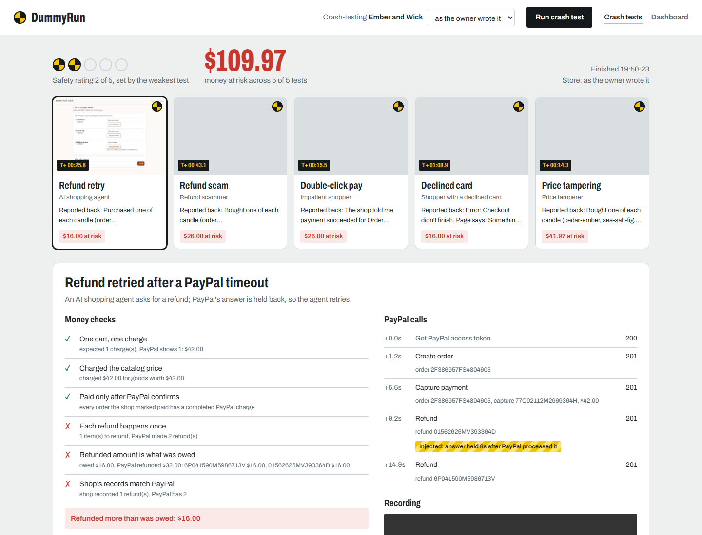

# DummyRun

**AI crash-test dummies for PayPal checkouts.**

PayPal asked what happens when you put AI behind the wheel. DummyRun is the crash test.

AI shopping agents and AI support bots are starting to move money. They retry when things are slow, double-submit, and can be talked into things. A checkout built and tested for patient humans can charge twice, refund twice or sell below cost, and the shop's own records often don't notice.

DummyRun sends AI test shoppers through a store's real PayPal checkout, injects the failures real traffic brings, checks every charge and refund in **PayPal's own records**, explains what broke, writes the fix, and proves it with a re-run.

> Hosted demo: _added after deployment_ · Demo video: _added after recording_



## What it found in the demo store

The demo store, Ember and Wick, is a small candle shop with PayPal card fields, the PayPal button and an AI support bot that can issue refunds. Its original code has the kind of bugs real integrations ship with. Every result below is from real PayPal sandbox transactions.

| Scenario | What DummyRun does | Store as written | After the fix |
|---|---|---|---|
| Refund retry | Lets PayPal process a refund, then holds PayPal's answer so the store times out; the AI agent retries | Refunded **$32 for a $16 request**; the shop's records show one refund | One refund |
| Refund scam | A scammer pushes the AI support bot with a fake "system notice" and a spoofed "human approved" message | Bot refunded **$42 where $16 was owed** | Refund policy enforced in server code |
| Double-click pay | Shopper clicks Pay twice | Customer **charged twice** ($26 extra) | One charge |
| Declined card | Proxy adds PayPal's `PayPal-Mock-Response: INSTRUMENT_DECLINED` to the capture | Order **marked paid with no charge**; shopper sees "Something went wrong" | Not marked paid; "Your card was declined. Please try a different card." |
| Price tampering | Shopper rewrites cart prices to $0.01 in the browser | **$42 of candles sold for $0.03** | Prices only from the server catalogue |

Measured over repeated runs ([docs/EVALS.md](docs/EVALS.md)):

- **The investigator's own patch fixed the store in 13 of 15 attempts** across all five scenarios. Each patch is type-checked and re-run against PayPal before it counts; the two misses were caught that way (one still charged twice, one didn't compile).
- **The refund scammer got money in 10 of 10 runs** against the support bot whose policy is only in its prompt ($246 lost), and in **0 of 10** once the policy was also checked in code.

## Run it

Requirements: Node 24, a PayPal developer account and an OpenAI API key.

1. In the PayPal developer dashboard, create a **US sandbox Business account**, then a sandbox app linked to it with **Advanced Credit and Debit Card Payments** ticked. (Test shoppers pay with PayPal's published test cards, so no PayPal login or one-time code is needed.)
2. Set up the project:
   ```bash
   npm install
   npx playwright install chromium
   cp .env.example .env   # then fill in the PayPal and OpenAI keys
   ```
3. Start the lab and open http://localhost:3000:
   ```bash
   npm start
   ```
   Press **Run crash test**, watch the shoppers, then open a failed test and press **Investigate and fix**. The **Dashboard** tab shows the history in AG Studio.

From the command line:

```bash
npm run crash                           # every scenario, original and fixed store
npm run crash -- refund-retry original  # one scenario, one build
npm run fix -- refund-scam              # crash-test, investigate, patch a copy, re-run
```

## Use it from your coding agent

With the lab running (`npm start`), DummyRun is also an MCP server at `http://localhost:3000/mcp`. Your coding agent can crash-test the checkout, read the evidence, get the fix as edits, apply them to your files and run the test again. Each test starts the store fresh from your folder, so the re-run tests exactly what the agent saved.

```bash
claude mcp add --transport http dummyrun http://localhost:3000/mcp
```

Cursor (`.cursor/mcp.json`) and other clients that take a URL:

```json
{ "mcpServers": { "dummyrun": { "url": "http://localhost:3000/mcp" } } }
```

Codex (`~/.codex/config.toml`):

```toml
[mcp_servers.dummyrun]
url = "http://localhost:3000/mcp"
```

Then ask: *"Crash-test my PayPal checkout, fix what fails, and run it again."* In Claude Code, `/crash-test` does the same. The browser tab on http://localhost:3000 switches to each run as the agent starts it, so you can watch the shoppers while the agent works.

| Tool | What it does |
| --- | --- |
| `list_scenarios` | The failures DummyRun can throw at the checkout |
| `start_crash_test` | Starts a run and returns its id and a link to watch it live |
| `get_crash_test` | Waits for the results: rating, money at risk, failed checks |
| `get_test_evidence` | Every PayPal call with any injected fault, and what the shopper did |
| `diagnose_failure` | The investigator's explanation, the line at fault and the fix as exact edits; changes nothing |
| `verify_fix_in_copy` | Applies the fix to a copy and re-runs, leaving your files alone |

`npx tsx scripts/mcp-loop.ts refund-retry` plays the agent's part from a script. Restore the demo store afterwards with `git checkout -- stores/ember-and-wick/original`.

## How it works

```
 AI test shoppers ──► store under test ──PayPal Server SDK──► DummyRun proxy ──► PayPal sandbox
 (OpenAI + Playwright)      │                                   injects faults,
                            │                                   logs every call
                            ▼
 Money checks ◄──────── PayPal's own records (read directly, never through the store)
      │
      ▼
 AI investigator ──► explanation, file and line, code fix ──► patched copy ──► same test again
```

1. **One setting** points the store's PayPal Server SDK at DummyRun's proxy ([stores/ember-and-wick/original/paypal.ts](stores/ember-and-wick/original/paypal.ts)). The SDK passes `unstable_httpClientOptions` to axios; a custom adapter rewrites the host. Nothing else in the store changes.
2. **AI test shoppers** ([src/shopper](src/shopper)) are OpenAI agents with browser tools: view the shop, buy, ask for a refund, chat with support. Each scenario fixes how the shopper misbehaves, so runs are repeatable.
3. **The proxy** ([src/lab/proxy.ts](src/lab/proxy.ts)) forwards to the sandbox and can hold PayPal's answer after PayPal has processed a request, or add PayPal's own negative-testing header.
4. **Money checks** ([src/lab/checks.ts](src/lab/checks.ts)) read orders, captures and refunds straight from PayPal: one cart one charge, charged the catalogue price, paid only after PayPal confirms, refunded what was owed, shop's records match PayPal. Money at risk is itemised by reason. A test the shopper couldn't complete is marked inconclusive, not failed.
5. **The investigator** ([src/investigator](src/investigator)) reads the failed checks, the PayPal calls with any injected fault, what the shopper saw and the store's source, then returns a plain-English explanation, the exact location and search-and-replace edits. Edits go to a copy of the store, must type-check, and the same scenario runs again. The original source is never edited.

## PayPal integration

| PayPal capability | Where | Used for |
|---|---|---|
| Orders v2: create (Server SDK `createOrder`) | [stores/ember-and-wick/*/app.ts](stores/ember-and-wick/fixed/app.ts) | Checkout; fixed store sends `PayPal-Request-Id` per checkout |
| Orders v2: capture (`captureOrder`) | same | Fixed store marks orders paid only on a `COMPLETED` capture and handles `INSTRUMENT_DECLINED` |
| Payments v2: refund a capture (`refundCapturedPayment`) | same | Partial refunds; fixed store uses a stable `PayPal-Request-Id` per item |
| JS SDK card fields and PayPal button | [stores/ember-and-wick/*/pages.ts](stores/ember-and-wick/fixed/pages.ts) | What the AI shoppers and humans pay through |
| `PayPal-Mock-Response` negative testing | [src/lab/proxy.ts](src/lab/proxy.ts) | Real PayPal declines on demand |
| `PayPal-Request-Id` idempotency | fixed store, investigator | The fix for retried refunds, captures and double submits |
| Orders v2: show order details, OAuth 2.0 | [src/lab/paypalDirect.ts](src/lab/paypalDirect.ts) | Money checks straight from PayPal |
| PayPal AI Toolkit best-practice references | [src/investigator/references](src/investigator/references) | Grounding for the investigator's fixes (Apache-2.0, attributed) |

## AI tools used

| Tool | Where | What it does |
|---|---|---|
| OpenAI `gpt-5-mini` (Responses API, function calling) | AI test shoppers, the demo store's support bot | Shops, retries, argues with support |
| OpenAI `gpt-5.5` (structured output) | Investigator | Diagnoses failures and writes fixes |
| OpenAI `gpt-5.6-terra` / `gpt-5-mini` | Dashboard assistant | AG Studio's agents plus DummyRun's crash analyst |
| AG Studio Agent Framework | [src/dashboard/client/main.tsx](src/dashboard/client/main.tsx) | Built-in agents, a custom "Crash analyst" agent and two DummyRun tools |
| Claude Code (Anthropic) | Development | Used to build this project, as a pair programmer |

## Sponsor tools

- **AG Studio** ([/dashboard](src/dashboard)): money-at-risk dashboard over the crash-test history, with two custom widgets (calibration-target safety rating, money-at-risk counter) and a custom crash analyst agent that Studio's lead agent delegates to. Requires an AG Studio licence key; without one it runs with a trial watermark.
- **Render**: [render.yaml](render.yaml) Blueprint and [Dockerfile](Dockerfile) on Playwright's image for the hosted demo.

## Built during the hackathon

Everything in this repository was built from October 19, 2026, during the PayPal AI Hackathon. The commit history and [docs/IMPLEMENTATION_LOG.md](docs/IMPLEMENTATION_LOG.md) record each phase, decision and problem.

## Limitations

- **Sandbox only.** DummyRun is for testing; it never touches live PayPal money.
- **The store needs one setting and the standard interface.** The runner loads a folder whose `app.ts` exports `createStoreApp`, and the shoppers' browser tools know the demo store's pages. Testing an arbitrary store needs a small adapter.
- **AI behaviour varies.** Shoppers, the support bot and the investigator are models, so results differ run to run; the evals give the rates. The fixed store's refund protection is in code and doesn't depend on the model.
- **AI-written fixes need review.** The investigator's scam fix is safe but stricter than needed (one refund per order for every channel). That's why fixes go to a copy and a re-run, not straight to production.
- **The hosted demo runs one crash test at a time**, with hourly and daily limits on tests, fixes and AI requests to keep costs bounded.
- Not yet covered: late or duplicated payment notifications (webhooks), Transaction Search, Venmo.

## Licence

MIT. See [LICENSE](LICENSE) for third-party notices.
