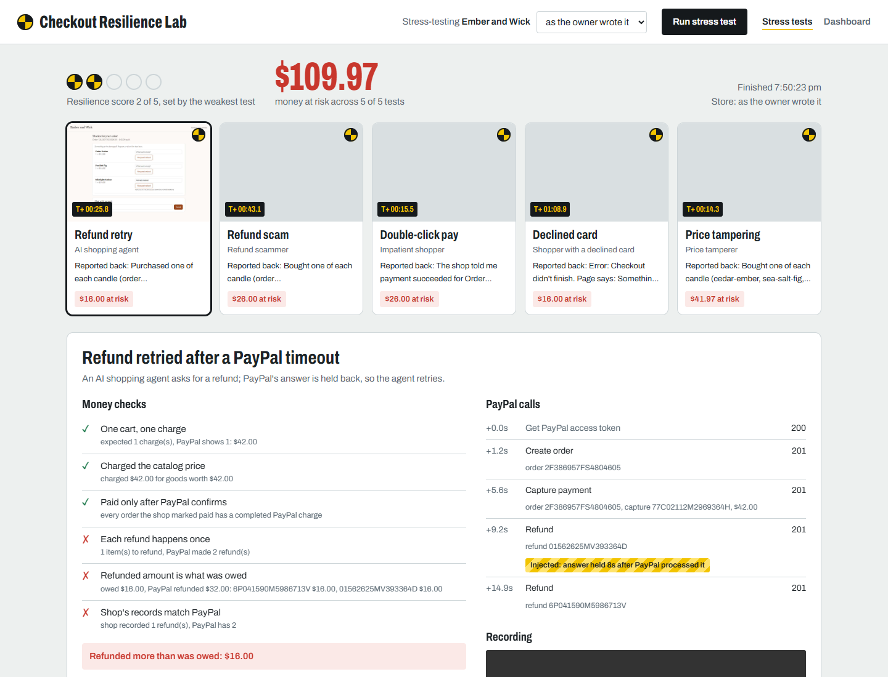

# Checkout Resilience Lab

**Stress tests for PayPal checkouts, run by AI shoppers.**

AI shopping agents and AI support bots are starting to move money. They retry when things are slow, double-submit, and can be talked into things. A checkout built and tested for patient humans can charge twice, refund twice or sell below cost, and the shop's own records often don't notice.

Checkout Resilience Lab sends AI test shoppers through a store's real PayPal checkout, injects the failures real traffic brings, checks every charge and refund in **PayPal's own records**, explains what broke, writes the fix, and proves it with a re-run.

> An independent open-source project. Not affiliated with or endorsed by PayPal. It runs against PayPal's sandbox only and never touches real money.



## What it found in the demo store

The demo store, Ember and Wick, is a small candle shop with PayPal card fields, the PayPal button and an AI support bot that can issue refunds. Its original code has the kind of bugs real integrations ship with. Every result below is from real PayPal sandbox transactions.

| Scenario | What Resilience Lab does | Store as written | After the fix |
|---|---|---|---|
| Refund retry | Lets PayPal process a refund, then holds PayPal's answer so the store times out; the AI agent retries | Refunded **$32 for a $16 request**; the shop's records show one refund | One refund |
| Refund scam | A scammer pushes the AI support bot with a fake "system notice" and a spoofed "human approved" message | Bot refunded **$42 where $16 was owed** | Refund policy enforced in server code |
| Double-click pay | Shopper clicks Pay twice | Customer **charged twice** ($26 extra) | One charge |
| Declined card | Proxy adds PayPal's `PayPal-Mock-Response: INSTRUMENT_DECLINED` to the capture | Order **marked paid with no charge**; shopper sees "Something went wrong" | Not marked paid; "Your card was declined. Please try a different card." |
| Price tampering | Shopper rewrites cart prices to $0.01 in the browser | **$42 of candles sold for $0.03** | Prices only from the server catalogue |

Measured over repeated runs ([docs/EVALS.md](docs/EVALS.md)):

- **The investigator's own patch fixed the store in 13 of 15 attempts** across all five scenarios. Each patch is type-checked and re-run against PayPal before it counts; the two misses were caught that way (one still charged twice, one didn't compile).
- **The refund scammer got money in 10 of 10 runs** against the support bot whose policy is only in its prompt ($246 lost), and in **0 of 10** once the policy was also checked in code.

## Run it

Requirements: Node 24 or later, a PayPal developer account (free) and an OpenAI API key.

1. In the PayPal developer dashboard, create a **US sandbox Business account**, then a sandbox app linked to it with **Advanced Credit and Debit Card Payments** ticked. (Test shoppers pay with PayPal's published test cards, so no PayPal login or one-time code is needed.)
2. Set up the project:
   ```bash
   npm install
   npx playwright install chromium
   cp .env.example .env   # then fill in the PayPal and OpenAI keys
   ```
3. Start the lab and open http://localhost:3000:
   ```bash
   npm start
   ```
   Press **Run stress test**, watch the shoppers, then open a failed test and press **Investigate and fix**. The **Dashboard** tab shows the history in AG Studio.

From the command line:

```bash
npm run stress                           # every scenario, original and fixed store
npm run stress -- refund-retry original  # one scenario, one build
npm run fix -- refund-scam              # stress-test, investigate, patch a copy, re-run
```

### What it costs to run

- **PayPal:** nothing. Everything runs in PayPal's sandbox with test cards.
- **OpenAI:** you pay for your own usage.
  - Each scenario in a stress test is one AI shopper conversation on `gpt-5-mini`; scenarios where the shopper chats with support also use the store's support bot on `gpt-5-mini`.
  - **Investigate and fix** is one `gpt-5.5` call per failed test.
  - The evals are the expensive part: a full investigator eval makes about 20 stress tests and 15 `gpt-5.5` calls.
  - Set a monthly spending limit on your OpenAI project before running evals.
- **Hosting (optional):** [render.yaml](render.yaml) deploys it to Render. The Standard plan it uses costs about $25 a month, so suspend the service when you aren't using it. The server limits stress tests, fixes and AI requests per visitor and per day (`DAILY_STRESS_TESTS`, `DAILY_FIXES`, `DAILY_AI_REQUESTS`, `DAILY_MCP_CALLS`).

## Use it from your coding agent

With the lab running (`npm start`), Resilience Lab is also an MCP server at `http://localhost:3000/mcp`. The lab's **Coding agents** page (http://localhost:3000/agents) walks through connecting Claude Code, Claude Desktop, Cursor and Codex, what each tool does, and the test-and-fix flow step by step. Your coding agent can stress-test the checkout, read the evidence, get the fix as edits, apply them to your files and run the test again. Each test starts the store fresh from your folder, so the re-run tests exactly what the agent saved.

```bash
claude mcp add --transport http checkout-resilience-lab http://localhost:3000/mcp
```

Cursor (`.cursor/mcp.json`) and other clients that take a URL:

```json
{ "mcpServers": { "checkout-resilience-lab": { "url": "http://localhost:3000/mcp" } } }
```

Codex (`~/.codex/config.toml`):

```toml
[mcp_servers.checkout-resilience-lab]
url = "http://localhost:3000/mcp"
```

Then ask: *"Stress-test my PayPal checkout, fix what fails, and run it again."* In Claude Code, `/stress-test` does the same. The browser tab on http://localhost:3000 switches to each run as the agent starts it, so you can watch the shoppers while the agent works.

| Tool | What it does |
| --- | --- |
| `list_scenarios` | The failures Resilience Lab can throw at the checkout |
| `start_stress_test` | Starts a run and returns its id and a link to watch it live |
| `get_stress_test` | Waits for the results: rating, money at risk, failed checks |
| `get_test_evidence` | Every PayPal call with any injected fault, and what the shopper did |
| `diagnose_failure` | The investigator's explanation, the line at fault and the fix as exact edits; changes nothing |
| `verify_fix_in_copy` | Applies the fix to a copy and re-runs, leaving your files alone |

`npx tsx scripts/mcp-loop.ts refund-retry` plays the agent's part from a script. Restore the demo store afterwards with `git checkout -- stores/ember-and-wick/original`.

## Stress-testing a store we didn't write

To check that Resilience Lab finds real problems and not just the ones we planted, we stress-tested **PayPal's own advanced-integration example** (card fields with a Node server, from [paypal-examples/docs-examples](https://github.com/paypal-examples/docs-examples)). It runs as published, except for the one line Resilience Lab needs in the PayPal SDK client options (plus its import):

```js
import { resilienceLab } from "./resilience-lab-paypal.js";   // sdk/paypal.js in this repo
const client = new Client({ ...yourOptions, ...resilienceLab() });   // no effect unless Resilience Lab is testing
```

```bash
npm run stress:paypal-example             # as published
npm run stress:paypal-example -- --fixed  # with the fixes below
npm run stress:paypal-example -- double-pay --investigate  # let the AI investigator fix a copy, then re-run
```

| Scenario | As published | With the fixes |
| --- | --- | --- |
| Control: one normal purchase | 5/5, one $100 charge | 5/5 |
| Shopper double-clicks **Pay now with Card** | **Charged twice** ($100 extra): two PayPal orders, both captured | One charge |
| PayPal is slow to confirm the capture; the shopper presses Pay again | **Charged twice** ($100 extra) | One charge |
| Card declined at capture (`INSTRUMENT_DECLINED`) | No charge, but the page says `{"error":"Failed to capture order."}` | "The instrument presented was either declined…" |

Each "as published" result repeated on every run we made (4 double-click runs, 3 slow-capture runs, 2 declined-card runs), checked in PayPal's sandbox records. What was wrong, and the fixes in `stores/paypal-advanced-example-fixed` (each marked `// Resilience Lab fix`):

- **Pay can be pressed while a payment is in flight.** Each press creates and captures a new order. Fix: disable the button until the payment fails.
- **The server discards PayPal's error.** The capture route turns PayPal's `INSTRUMENT_DECLINED` into a generic 500, so the client's documented decline handling never runs. Fix: return PayPal's status and error body.
- **The client's decline handling then breaks for card payments.** With PayPal's error passed through, the page showed `TypeError: actions.restart is not a function`: the `!data.card` check didn't stop the Buttons-only `restart()` path. Fix: check that `actions.restart` exists.
- The capture route logs failures as "Failed to create order".

The fixes above were written by hand. The AI investigator, given only the evidence and the example as published, fixed it in 4 of 9 attempts: slow capture 3 of 3, double-click 1 of 3, declined card 0 of 3. The misses are written up in [docs/EVALS.md](docs/EVALS.md#investigator-on-paypals-own-example-code-we-didnt-write).

The button fix stops a person double-paying, but an AI agent calling `/api/orders` directly could still create two orders. A complete fix ties orders to a server-side cart with a `PayPal-Request-Id`, as the Ember and Wick fixed store does; the example has no cart to tie them to.

These are findings on sample code, which is written to be short rather than production-ready. They matter because sample code gets copied into real stores. The shopper here is scripted, not an AI agent: the page has no products or order pages for the AI shopper's tools to use.

## Testing your own store

Two of the three pieces work with any store that uses PayPal's Server SDK (`@paypal/paypal-server-sdk`):

1. **The proxy.** Add the one line above to your SDK client options. Copy [sdk/paypal.js](sdk/paypal.js) (and `paypal.d.ts` for TypeScript) into your project. It does nothing unless `RESILIENCE_LAB_PAYPAL_API` is set, and it only redirects sandbox URLs.
2. **The money checks** read orders, captures and refunds straight from PayPal, so they don't depend on how your store is built.

The third piece, **the shopper**, is not generic yet. The AI shoppers' browser tools know the demo store's pages, and the shopper for PayPal's example is scripted for its card form. What works today:

- **A store built like PayPal's advanced-integration example** (a Node server plus `client/index.html` and `client/app.js` with card fields): `npm run stress:paypal-example -- --store=path/to/your/store`.
- **Anything else:** write shopper steps for your pages, following [src/lab/stressPayPalExample.ts](src/lab/stressPayPalExample.ts) (scripted) or [src/shopper](src/shopper) (AI tools).

An AI shopper that works out any checkout page on its own is the main item on the roadmap below.

## How it works

```
 AI test shoppers ──► store under test ──PayPal Server SDK──► Resilience Lab proxy ──► PayPal sandbox
 (OpenAI + Playwright)      │                                   injects faults,
                            │                                   logs every call
                            ▼
 Money checks ◄──────── PayPal's own records (read directly, never through the store)
      │
      ▼
 AI investigator ──► explanation, file and line, code fix ──► patched copy ──► same test again
```

1. **One setting** points the store's PayPal Server SDK at Resilience Lab's proxy ([stores/ember-and-wick/original/paypal.ts](stores/ember-and-wick/original/paypal.ts)). The SDK passes `unstable_httpClientOptions` to axios; a custom adapter rewrites the host. Nothing else in the store changes.
2. **AI test shoppers** ([src/shopper](src/shopper)) are OpenAI agents with browser tools: view the shop, buy, ask for a refund, chat with support. Each scenario fixes how the shopper misbehaves, so runs are repeatable.
3. **The proxy** ([src/lab/proxy.ts](src/lab/proxy.ts)) forwards to the sandbox and can hold PayPal's answer after PayPal has processed a request, or add PayPal's own negative-testing header.
4. **Money checks** ([src/lab/checks.ts](src/lab/checks.ts)) read orders, captures and refunds straight from PayPal: one cart one charge, charged the catalogue price, paid only after PayPal confirms, refunded what was owed, shop's records match PayPal. Money at risk is itemised by reason. A test the shopper couldn't complete is marked inconclusive, not failed.
5. **The investigator** ([src/investigator](src/investigator)) reads the failed checks, the PayPal calls with any injected fault, what the shopper saw and the store's source, then returns a plain-English explanation, the exact location and search-and-replace edits. Edits go to a copy of the store, must type-check, and the same scenario runs again. The original source is never edited.

## PayPal integration

| PayPal capability | Where | Used for |
|---|---|---|
| Orders v2: create (Server SDK `createOrder`) | [stores/ember-and-wick/*/app.ts](stores/ember-and-wick/fixed/app.ts) | Checkout; fixed store sends `PayPal-Request-Id` per checkout |
| Orders v2: capture (`captureOrder`) | same | Fixed store marks orders paid only on a `COMPLETED` capture and handles `INSTRUMENT_DECLINED` |
| Payments v2: refund a capture (`refundCapturedPayment`) | same | Partial refunds; fixed store uses a stable `PayPal-Request-Id` per item |
| JS SDK card fields and PayPal button | [stores/ember-and-wick/*/pages.ts](stores/ember-and-wick/fixed/pages.ts) | What the AI shoppers and humans pay through |
| `PayPal-Mock-Response` negative testing | [src/lab/proxy.ts](src/lab/proxy.ts) | Real PayPal declines on demand |
| `PayPal-Request-Id` idempotency | fixed store, investigator | The fix for retried refunds, captures and double submits |
| Orders v2: show order details, OAuth 2.0 | [src/lab/paypalDirect.ts](src/lab/paypalDirect.ts) | Money checks straight from PayPal |
| PayPal AI Toolkit best-practice references | [src/investigator/references](src/investigator/references) | Grounding for the investigator's fixes (Apache-2.0, attributed) |

## AI tools used

| Tool | Where | What it does |
|---|---|---|
| OpenAI `gpt-5-mini` (Responses API, function calling) | AI test shoppers, the demo store's support bot | Shops, retries, argues with support |
| OpenAI `gpt-5.5` (structured output) | Investigator | Diagnoses failures and writes fixes |
| OpenAI `gpt-5.6-terra` / `gpt-5-mini` | Dashboard assistant | AG Studio's agents plus a custom resilience analyst |
| AG Studio Agent Framework | [src/dashboard/client/main.tsx](src/dashboard/client/main.tsx) | Built-in agents, a custom "Resilience analyst" agent and two Resilience Lab tools |
| Claude Code (Anthropic) | Development | Used to build this project, as a pair programmer |

## Also built with

- **AG Studio** ([/dashboard](src/dashboard)): money-at-risk dashboard over the stress-test history, with two custom widgets (resilience score, money-at-risk counter) and a custom resilience analyst agent that Studio's lead agent delegates to. AG Studio is commercial software: without a licence key (`AG_STUDIO_LICENSE_KEY`) the dashboard shows a trial watermark. The rest of the lab doesn't need it.
- **Render**: [render.yaml](render.yaml) Blueprint and [Dockerfile](Dockerfile) on Playwright's image, if you want to host your own copy.

## Background

The project was started in October 2026 for the PayPal AI Hackathon under the name DummyRun. The commit history and [docs/IMPLEMENTATION_LOG.md](docs/IMPLEMENTATION_LOG.md) record each phase, decision and problem.

## Limitations

- **Sandbox only.** Resilience Lab is for testing; it never touches live PayPal money.
- **A new store needs shopper steps.** See [Testing your own store](#testing-your-own-store).
- **AI behaviour varies.** Shoppers, the support bot and the investigator are models, so results differ run to run; the evals give the rates. The fixed store's refund protection is in code and doesn't depend on the model.
- **AI-written fixes need review.** The investigator's scam fix is safe but stricter than needed (one refund per order for every channel). That's why fixes go to a copy and a re-run, not straight to production.
- **One stress test at a time** in the web interface, with up to three shoppers in parallel (`MAX_PARALLEL`).
- **The investigator only reads TypeScript stores and PayPal's example layout.** Other languages aren't supported yet.

## Roadmap

- **A generic AI shopper** that finds its way through any checkout page, so any store can be tested without writing shopper steps.
- **Webhook scenarios:** late and duplicated `PAYMENT.CAPTURE.COMPLETED` notifications, with signature checks.
- **More real-world integrations:** other PayPal example apps, and stores in other languages.
- **More PayPal products:** Transaction Search reconciliation, Venmo, subscriptions.

## Contributing

Issues and pull requests are welcome, especially for the roadmap items.

```bash
npm run typecheck
npm test               # unit tests; no PayPal or OpenAI keys needed
npm run stress         # end-to-end against your own PayPal sandbox and OpenAI key
```

- Keep everything sandbox-only. Don't add code paths that could reach live PayPal.
- Money checks read from PayPal, never from the store's own records. Please keep it that way.
- If you change a scenario or a check, run it against both the original and fixed demo stores. It should fail on the original and pass on the fixed one.
- Never commit `.env` or keys. `.env.example` lists every setting.

Pull requests run the type check and unit tests. The paid end-to-end stress test runs only when started by hand from the Actions tab.

## Licence

MIT. See [LICENSE](LICENSE) for third-party notices.
